# KAWA — Pocket Tracker by Omnipotard

[English](README.md) · [Français](README.fr.md) · **Español**

KAWA es un firmware tracker para el **M-VAVE FM-1**, pensado para chiptune, breakcore y breakbeat. Tiene
seis pistas: dos ondas de pulso, una onda de 4 bits, ruido, una batería y un break cortado en 16 trozos.
Encima hay 32 efectos en directo al estilo Pocket Operator, y herramientas «mágicas» que escriben ritmos,
melodías y cortes de break por ti. La pantalla habla inglés, francés o español.

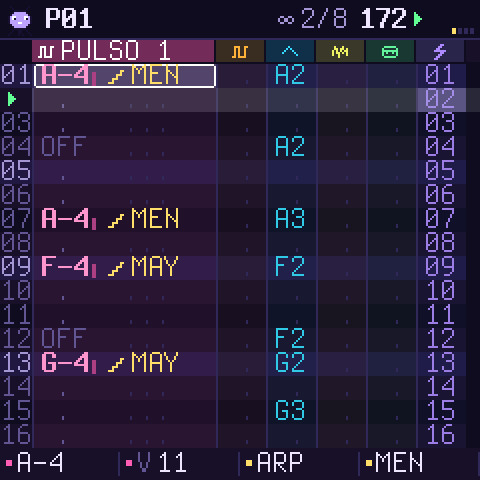

> **Estado: 0.1, beta.** Compila, pasa las comprobaciones de la plataforma y funciona en el simulador y en
> el emulador web. Todavía no se ha probado en un FM-1 real. Instalar un firmware no oficial es bajo tu
> propio riesgo. Lee [Instalar](#instalar) y [Volver atrás](#volver-atrás) antes de empezar.

## Pruébalo en el navegador

El código C del firmware está compilado a WebAssembly, con el panel del FM-1 dibujado alrededor:
[`emulateur/index.html`](emulateur/index.html). Ábrelo en Chrome, Edge o Firefox, pulsa **ENCENDER** y
luego **PLAY**. La página y la pantalla cambian de idioma (EN / FR / ES) arriba a la derecha. Puedes usar
el ratón, la pantalla táctil o el teclado del ordenador. Un teclado MIDI USB también funciona (Web MIDI).


## La idea

- **Un tracker de verdad, sin la austeridad.** Seis pistas de colores una al lado de otra, y la del cursor
  mostrada en grande. Las notas se escriben `C-4`, la percusión por su nombre (`KIK`, `SNR`…) y los trozos
  del break por su número (`S05`). Cada celda tiene un **truco**, mostrado con un icono: arpegio, redoble,
  glissando…
- **La línea de abajo siempre dice lo que hacen los cuatro potenciómetros** en la página donde estás.
- **Ideas de Pocket Operator por todas partes.** Las 16 teclas blancas son los 16 pasos (página REJILLA),
  los 16 efectos en directo (FX mantenido) y las 16 herramientas mágicas (LFO).
- **Hecho para los breaks.** El break está cortado en 16 trozos en las 16 teclas blancas. Las teclas negras
  tocan el mismo trozo al revés. El PICADOR reescribe un patrón de cortes, manteniendo un bombo en los
  tiempos fuertes y cajas en el 2 y el 4.
- **Ninguna nota falsa, salvo que la quieras.** Con la escala fijada, las teclas y el potenciómetro 1 se
  quedan en la escala.
- **Una mascota** vive en la esquina. Salta a tiempo y reacciona a los efectos: se da la vuelta con REVÉS,
  se aplasta con TRITURA y se duerme con PARADA DE CINTA.

## El panel

| Botón | Página | Qué hace |
| --- | --- | --- |
| **HOME** | PISTAS | el tracker. Mantenido: el mapa de los botones |
| **SEQ** | REJILLA | los 16 pasos de la pista en las teclas blancas; las teclas negras 1 a 6 eligen la pista |
| **EDIT** | SONIDO | el sonido de la pista: PRESETS elige un sonido de fábrica, los potenciómetros ajustan sus parámetros, EDIT otra vez muestra la página siguiente |
| **ENV** | MEZCLA | volumen, panorama, eco y tono por pista; las teclas negras silencian pistas |
| **LFO** | MAGIA | 16 herramientas en las teclas blancas (más abajo) |
| **SCL** | ESCALA | la tónica (pulsa una tecla), la escala, el bloqueo, cuánto avanza el cursor tras una nota |
| **GLO** | CANCIÓN | tempo, swing, largo del patrón, bucle o canción; la lista de patrones (las teclas blancas añaden los patrones 1 a 16) |
| **SAVE** | PROYECTO | 4 ranuras y el guardado automático; el potenciómetro 3 elige el **idioma**. Mantenido: **deshacer** |
| **FX** | EFECTOS | mantenlo y toca las teclas blancas; un toque corto deja la página abierta. OCT-/OCT+ cambian de banco |
| **ARP** | — | borra la celda bajo el cursor |
| **PLAY / REC** | — | reproducir y parar; grabar (paso a paso en el cursor, o en directo a tiempo) |

Potenciómetros: **SELECT** pasa de una fila a otra, **ALGORITHM** elige la pista, **PRESETS** elige el
patrón (o el sonido, o la entrada de la canción). **KNOB 1 a 4** hacen lo que dice la línea de abajo. En
PISTAS son la nota, el volumen, el truco y su valor en la celda. **MASTER** es el volumen.

## Las seis pistas

| Pista | Sonido |
| --- | --- |
| PULSO 1, PULSO 2 | ondas de pulso sin aliasing al 12,5, 25, 50 o 75 %, o PWM; ADSR, barrido de tono, vibrato, trituración |
| ONDA | tablas de onda de 32 pasos y 4 bits, estilo Game Boy: triángulo, sierra, seno, suave, bajo GB, órgano, voz, FM |
| RUIDO | un LFSR de 15 bits estilo NES, en modo LARGO o METAL, afinado por la nota |
| KIT | 16 percusiones sintetizadas: bombo, bombo gabber, caja, palmas, charles, toms, platillo, ride, cencerro, aro, zap, 808, bombo chip, caja chip |
| BREAK | cuatro breaks (tipo amen, think, funky, jungle) sintetizados desde cero, 16 trozos; puede seguir el tempo |

Cada pista tiene volumen, panorama, un envío de eco y un filtro de tono. El eco va a tempo (3/16).

## Los trucos (la columna FX de una celda)

ARPEGIO (14 acordes, velocidad chiptune) · GLISSANDO · VIBRATO · REDOBLE (x2 a x32 en una fila) · BEND ·
AZAR · RETRASO (en 1/24 de fila) · CORTE · REVÉS (un trozo de break al revés) · ALTURA (±12) · FORMA ·
TRITURA.

## Efectos en directo (FX mantenido)

| Tecla | Banco BOLSA | Banco ROTO |
| --- | --- | --- |
| 1-4 | BUCLE 1/16, 1/12, 1/32, 1/64 | TRITURA 4 bits, DIEZMA, FILTRO GRAVES, FILTRO AGUDOS |
| 5-8 | UNÍSONO, UNÍSONO GRAVE, OCTAVA +1, OCTAVA −1 | PARADA DE CINTA, PICADO, GATE 1/16, GATE 1/32 |
| 9-12 | TARTAMUDEO x4, TARTAMUDEO x3, SCRATCH, SCRATCH RÁPIDO | CONGELA, ANILLO, ECO, DISTORSIÓN |
| 13-16 | 6/8 SWING, REPITE 1 PULSO, REVÉS, REDOBLE ACELERADO | WOBBLE, VINILO, SIN MELODÍA, SIN RITMO |

Los bucles se ajustan al tiempo: la primera pasada es el sonido en directo y luego se repite. Mantén varias
teclas a la vez para sumar efectos. Con REC encendido y la música sonando, los efectos que tocas se
**graban** en la pista LIVE del patrón (la franja fina a la derecha del tracker). ARP, en la página
EFECTOS, borra esa pista.

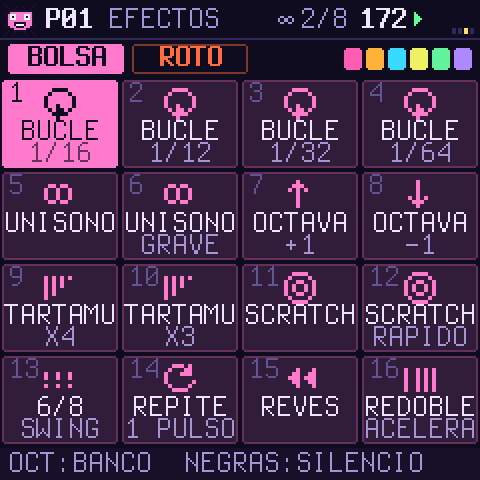

## La magia (LFO)

PICADOR · RITMO · MELODÍA · BAJO · ARPEGIO · EUCLIDES · VARIAR · REDOBLES · MATICES · DUPLICA · MOVER ·
ESPEJO · TRANSPONER · COPIAR · PEGAR · BORRAR. El potenciómetro 1 ajusta la fuerza, el 2 el dado, y el 3
elige entre la pista y el patrón entero. En el patrón entero, cada pista recibe lo que le va: un bajo en
ONDA, un ritmo en la percusión, una melodía en los pulsos. Cada herramienta se puede deshacer (SAVE
mantenido).

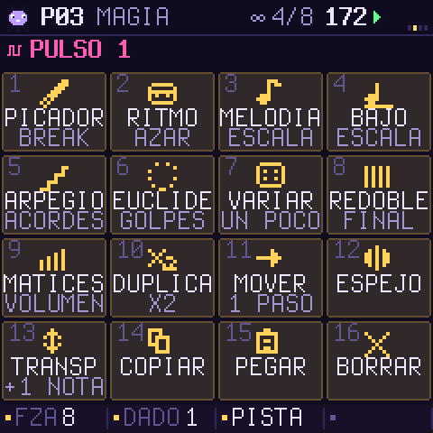

## Más pantallas

| | | |
| --- | --- | --- |
| 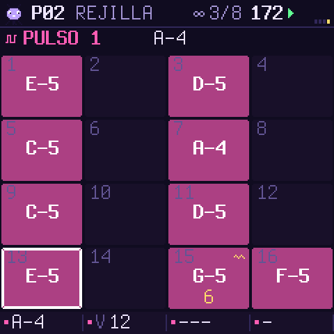 | 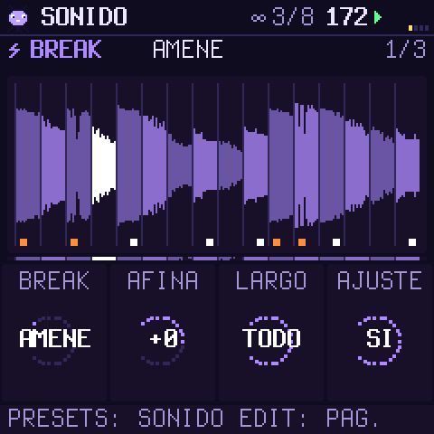 | 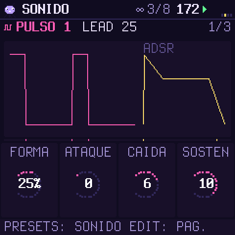 |
| 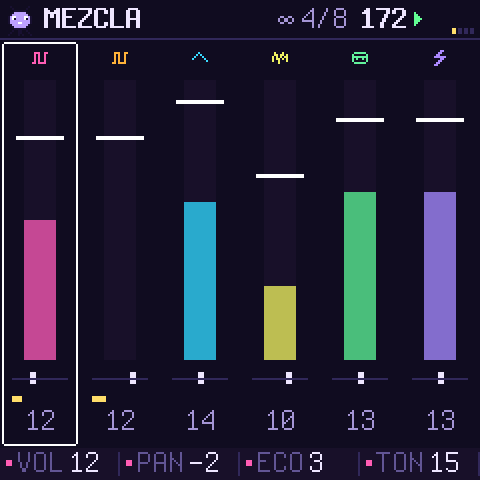 | 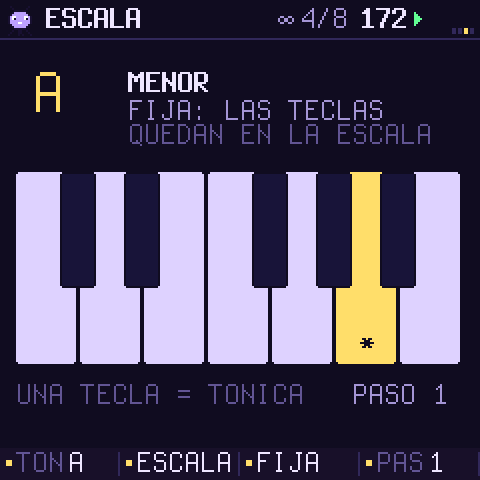 | 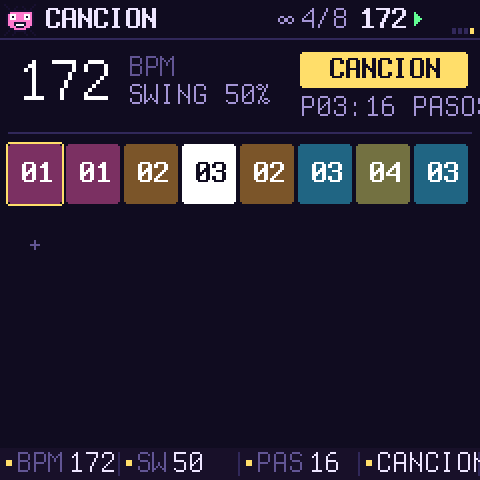 |
| 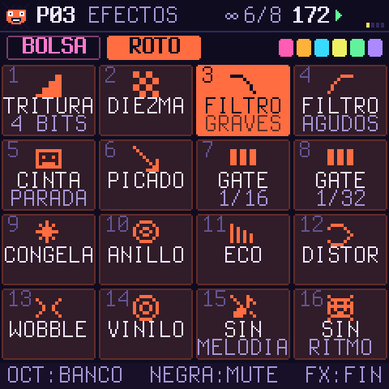 | 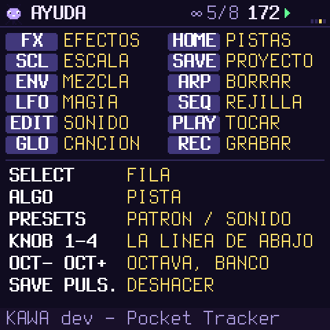 |  |

## Instalar

Necesitas el paquete `release/kawa-0.1.fwsc` (o tu propia compilación), un cable USB de datos, y Python 3
con `pip3 install mido python-rtmidi`.

```sh
python3 tools/fm1_install.py --info                 # lo que ejecuta el FM-1 conectado
python3 tools/fm1_install.py release/kawa-0.1.fwsc  # pregunta antes de escribir y reinicia en KAWA
```

KAWA conserva el camino de actualización de su plataforma: los instaladores de la comunidad FM-1 (y el de
M-VAVE) siempre pueden volver a alcanzarlo.

## Volver atrás

- **Al firmware oficial:** descarga el FM-1 V15 de la web de M-VAVE e instálalo con M-UPGRADE. Otro
  instalador de la comunidad también sirve, por ejemplo la opción «volver al firmware oficial» de los
  instaladores web de Felucca o FoMni.
- **Si KAWA no arranca:** mantén **OCT−** al encender. Así se abre el rescate USB, sin sonido, solo con la
  actualización. Si KAWA se cuelga dos veces al arrancar, el FM-1 va ahí solo.
- **Si ni eso responde:** la ROM de arranque del chip todavía responde por USB (`WL80UBOOT`).
  [FM-1 Transporter](https://github.com/kurogedelic/FM-1-transporter) puede volver a escribir el firmware
  oficial.

## Compilarlo

- `tests/run_host.sh [script]` ejecuta KAWA en tu ordenador: pantallas en PNG, sonido en WAV. No hace falta
  un FM-1 ni un compilador especial.
- `web/make_emulator.sh` construye el emulador web. Hace falta clang con el destino wasm32, y wasm-ld.
- `./build.sh` construye el paquete del FM-1. Hace falta el compilador de JieLi (`tools/get_toolchain.sh`)
  y tres archivos del SDK JieLi AC79 (Apache-2.0). Ver [BUILDING.md](BUILDING.md) (en inglés).
- `./build.sh --release 0.1` produce `build/kawa-0.1.fwsc` (identidad `FM-1_951`).

## Créditos y licencia

KAWA por Omnipotard. GPL-3.0-only: puedes usarlo, cambiarlo y compartirlo, y quien reciba un firmware
construido a partir de él recibe también su código fuente. Se apoya en
[Dinghy](https://github.com/zvenson/dinghy) (zvenson), [Felucca](https://github.com/hugelton/Felucca)
(Leo Kuroshita, Hügelton Instruments) y [SLOOP](https://github.com/isod89/sloop-fm1) (isod89). Los
detalles están en [LICENSING.md](LICENSING.md). «M-VAVE» y «FM-1» pertenecen a sus dueños; KAWA no está
hecho ni avalado por ellos.
