# KAWA — Pocket Tracker by Omnipotard

[English](README.md) · **Français** · [Español](README.es.md)

KAWA est un firmware tracker pour le **M-VAVE FM-1**, pensé pour la chiptune, le breakcore et le
breakbeat. Il a six pistes : deux carrés, une onde 4 bits, un bruit, un kit de batterie et un break découpé
en 16 tranches. Par-dessus viennent 32 effets live façon Pocket Operator, et des outils « magiques » qui
écrivent des beats, des mélodies et des découpes de break à ta place. L'écran parle français, anglais ou
espagnol.

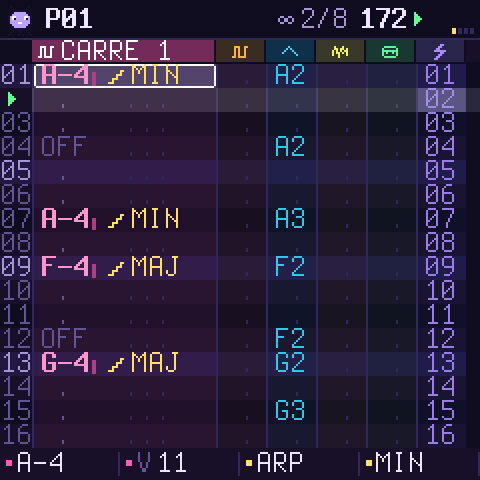

> **État : 0.1, bêta.** Il compile, passe les vérifications de la plateforme et tourne dans le simulateur
> et l'émulateur web. Il n'a pas encore été essayé sur un vrai FM-1. Installer un firmware non officiel se
> fait à tes risques. Lis [Installer](#installer) et [Revenir en arrière](#revenir-en-arrière) avant de
> commencer.

## L'essayer dans le navigateur

Le code C du firmware est compilé en WebAssembly, avec le panneau du FM-1 dessiné autour :
[`emulateur/index.html`](emulateur/index.html). Ouvre-le dans Chrome, Edge ou Firefox, appuie sur
**ALLUMER**, puis sur **PLAY**. La page et l'écran passent d'une langue à l'autre (EN / FR / ES) en haut à
droite. Tu peux utiliser la souris, le tactile ou le clavier de l'ordinateur. Un clavier MIDI USB marche
aussi (Web MIDI).

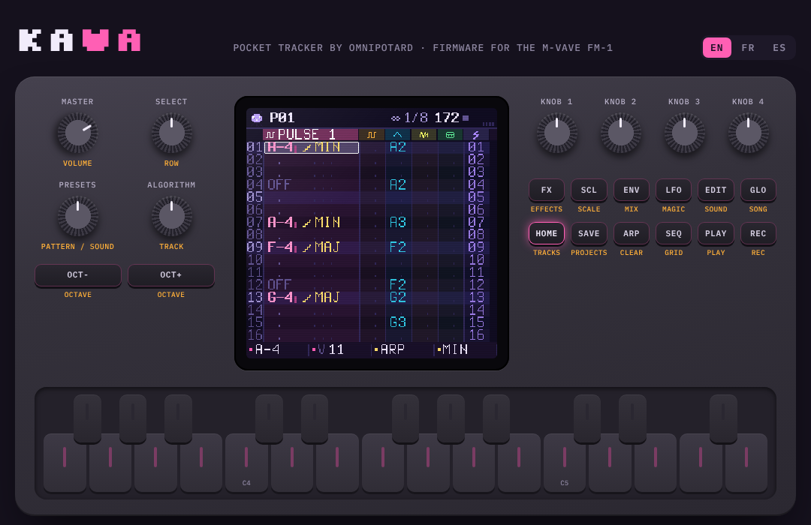

## L'idée

- **Un vrai tracker, sans l'austérité.** Six pistes colorées côte à côte, et celle du curseur affichée en
  large. Les notes s'écrivent `C-4`, les percussions par leur nom (`KIK`, `CAI`…) et les tranches du break
  par leur numéro (`S05`). Chaque case a une **astuce**, montrée par une icône : arpège, roulé, glissé…
- **La ligne du bas dit toujours ce que font les quatre potards** de la page où tu es.
- **Des idées de Pocket Operator partout.** Les 16 touches blanches sont les 16 pas (page GRILLE), les 16
  effets live (FX tenu) et les 16 outils magiques (LFO).
- **Fait pour les breaks.** Le break est découpé en 16 tranches sur les 16 touches blanches. Les touches
  noires jouent la même tranche à l'envers. Le HACHOIR réécrit un motif de découpes, en gardant un kick sur
  les temps forts et des caisses sur 2 et 4.
- **Pas de fausse note, sauf si tu en veux.** Quand la gamme est verrouillée, les touches et le potard 1
  restent dans la gamme.
- **Une mascotte** vit dans le coin. Elle saute sur le temps et réagit aux effets : elle se retourne sur
  ENVERS, s'écrase sur ÉCRASE et s'endort sur STOP K7.

## Le panneau

| Bouton | Page | Ce qu'il fait |
| --- | --- | --- |
| **HOME** | PISTES | le tracker. Tenu : la carte des boutons |
| **SEQ** | GRILLE | les 16 pas de la piste sur les touches blanches ; les touches noires 1 à 6 choisissent la piste |
| **EDIT** | SON | le son de la piste : PRESETS choisit un son d'usine, les potards règlent ses paramètres, EDIT à nouveau montre la page suivante |
| **ENV** | MIX | volume, panoramique, écho et tonalité par piste ; les touches noires coupent les pistes |
| **LFO** | MAGIE | 16 outils sur les touches blanches (plus bas) |
| **SCL** | GAMME | la tonique (appuie sur une touche), la gamme, le verrou, le pas du curseur après une note |
| **GLO** | CHAINE | tempo, swing, longueur du motif, boucle ou chaîne ; la liste des motifs (les touches blanches ajoutent les motifs 1 à 16) |
| **SAVE** | PROJETS | 4 emplacements et la sauvegarde auto ; le potard 3 règle la **langue**. Tenu : **annuler** |
| **FX** | EFFETS | tiens-le et joue les touches blanches ; un appui court garde la page ouverte. OCT-/OCT+ changent de banque |
| **ARP** | — | efface la case sous le curseur |
| **PLAY / REC** | — | lecture et arrêt ; enregistrement (pas à pas au curseur, ou en direct sur le temps) |

Potards : **SELECT** passe d'une ligne à l'autre, **ALGORITHM** choisit la piste, **PRESETS** choisit le
motif (ou le son, ou l'entrée de la chaîne). **KNOB 1 à 4** font ce que dit la ligne du bas. Sur PISTES,
ce sont la note, le volume, l'astuce et sa valeur de la case. **MASTER** règle le volume.

## Les six pistes

| Piste | Son |
| --- | --- |
| CARRÉ 1, CARRÉ 2 | carrés sans repliement à 12,5, 25, 50 ou 75 %, ou PWM ; ADSR, balayage de hauteur, vibrato, écrasement |
| ONDE | tables d'onde de 32 pas sur 4 bits, façon Game Boy : triangle, scie, sinus, doux, basse GB, orgue, voix, FM |
| BRUIT | un LFSR 15 bits façon NES, en mode LONG ou MÉTAL, accordé par la note |
| KIT | 16 percussions synthétisées : kick, kick gabber, caisse claire, clap, charleys, toms, cymbale, ride, cloche, rim, zap, 808, kick chip, caisse chip |
| CASSE | quatre breaks (façon amen, think, funky, jungle) synthétisés de zéro, 16 tranches ; peut suivre le tempo |

Chaque piste a son volume, son panoramique, un départ d'écho et un filtre de tonalité. L'écho est calé sur
le tempo (3/16).

## Les astuces (la colonne FX d'une case)

ARPÈGE (14 accords, vitesse chiptune) · GLISSÉ · VIBRATO · ROULÉ (x2 à x32 dans une ligne) · BEND ·
CHANCE · RETARD (en 1/24 de ligne) · COUPE · ENVERS (une tranche de break à l'envers) · HAUTEUR (±12) ·
FORME · ÉCRASE.

## Effets live (FX tenu)

| Touche | Banque POCHE | Banque CASSE |
| --- | --- | --- |
| 1-4 | BOUCLE 1/16, 1/12, 1/32, 1/64 | ÉCRASE 4 bits, DÉCIME, FILTRE BAS, FILTRE HAUT |
| 5-8 | UNISSON, UNISSON BAS, OCTAVE +1, OCTAVE −1 | STOP K7, PLONGÉE, HACHE 1/16, HACHE 1/32 |
| 9-12 | BÉGAIE x4, BÉGAIE x3, SCRATCH, SCRATCH VITE | GEL, ANNEAU, ÉCHO, DISTO |
| 13-16 | 6/8 TRIOLET, RELANCE 1 TEMPS, ENVERS, ROULEAU ACCÉLÉRÉ | WOBBLE, VINYLE, SANS MÉLO, SANS BEAT |

Les boucles se calent sur le temps : le premier passage est le son en direct, puis il se répète. Tiens
plusieurs touches à la fois pour empiler les effets. Avec REC allumé et la musique qui tourne, les effets
que tu joues sont **enregistrés** dans la piste LIVE du motif (la fine bande à droite du tracker). ARP, sur
la page EFFETS, efface cette piste.

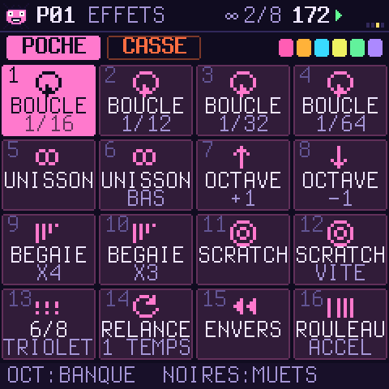

## La magie (LFO)

HACHOIR · BEAT · MÉLODIE · BASSE · ARPÈGES · EUCLIDE · VARIER · ROULÉS · NUANCES · DOUBLER · DÉCALER ·
MIROIR · TRANSPO · COPIER · COLLER · EFFACER. Le potard 1 règle la force, le potard 2 le dé, et le potard 3
choisit entre la piste et le motif entier. Sur le motif entier, chaque piste reçoit ce qui lui va : une
basse sur ONDE, un beat sur les percussions, une mélodie sur les carrés. Chaque outil peut être annulé (SAVE
tenu).

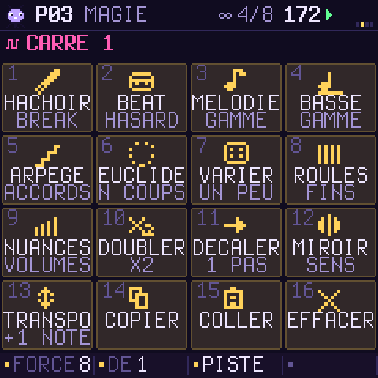

## D'autres écrans

| | | |
| --- | --- | --- |
| 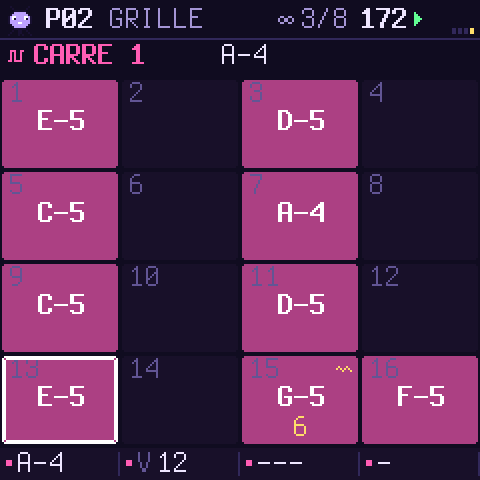 | 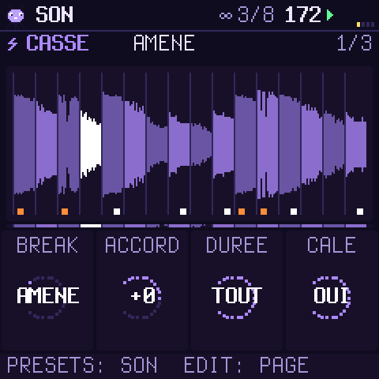 | 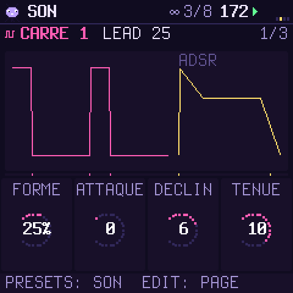 |
|  | 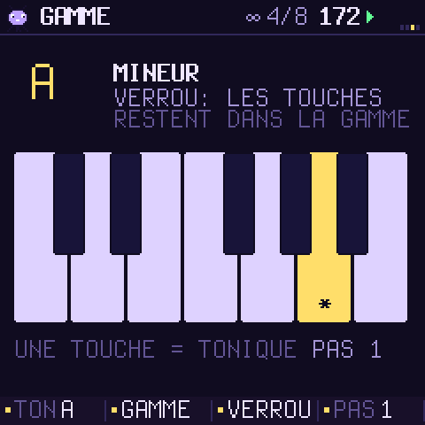 | 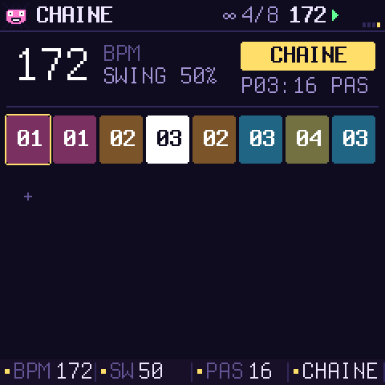 |
| 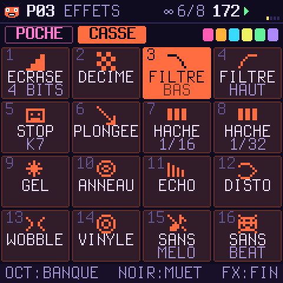 | 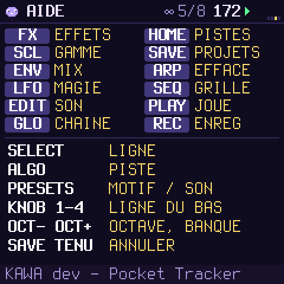 |  |

## Installer

Il te faut le paquet `release/kawa-0.1.fwsc` (ou ta propre compilation), un câble USB de données, et
Python 3 avec `pip3 install mido python-rtmidi`.

```sh
python3 tools/fm1_install.py --info                 # ce que tourne le FM-1 branché
python3 tools/fm1_install.py release/kawa-0.1.fwsc  # demande avant d'écrire, puis redémarre sur KAWA
```

KAWA garde le chemin de mise à jour de sa plateforme : les installeurs de la communauté FM-1 (et celui de
M-VAVE) peuvent toujours le joindre.

## Revenir en arrière

- **Vers le firmware officiel :** télécharge le FM-1 V15 sur le site de M-VAVE et installe-le avec
  M-UPGRADE. Un autre installeur de la communauté marche aussi, par exemple l'option « retour au firmware
  officiel » des installeurs web de Felucca ou de FoMni.
- **Si KAWA ne démarre pas :** tiens **OCT−** en allumant. Ça ouvre le secours USB, sans son, avec seulement
  la mise à jour. Si KAWA plante deux fois au démarrage, le FM-1 y va tout seul.
- **Si même ça ne répond plus :** la ROM de démarrage de la puce répond encore en USB (`WL80UBOOT`).
  [FM-1 Transporter](https://github.com/kurogedelic/FM-1-transporter) peut réécrire le firmware officiel.

## Le compiler

- `tests/run_host.sh [script]` fait tourner KAWA sur ton ordinateur : écrans en PNG, son en WAV. Pas
  besoin de FM-1 ni de compilateur spécial pour ça.
- `web/make_emulator.sh` construit l'émulateur web. Il faut clang avec la cible wasm32, et wasm-ld.
- `./build.sh` construit le paquet FM-1. Il faut le compilateur JieLi (`tools/get_toolchain.sh`) et trois
  fichiers du SDK JieLi AC79 (Apache-2.0). Voir [BUILDING.md](BUILDING.md) (en anglais).
- `./build.sh --release 0.1` produit `build/kawa-0.1.fwsc` (identité `FM-1_951`).

## Crédits et licence

KAWA par Omnipotard. GPL-3.0-only : tu peux l'utiliser, le modifier et le partager, et qui reçoit un
firmware construit à partir de lui reçoit aussi son code source. Il repose sur
[Dinghy](https://github.com/zvenson/dinghy) (zvenson), [Felucca](https://github.com/hugelton/Felucca)
(Leo Kuroshita, Hügelton Instruments) et [SLOOP](https://github.com/isod89/sloop-fm1) (isod89). Les
détails sont dans [LICENSING.md](LICENSING.md). « M-VAVE » et « FM-1 » appartiennent à leurs propriétaires ;
KAWA n'est ni fait ni approuvé par eux.
