# KAWA — Pocket Tracker by Omnipotard

**English** · [Français](README.fr.md) · [Español](README.es.md)

KAWA is a tracker firmware for the **M-VAVE FM-1**, made for chiptune, breakcore and breakbeat. It has
six tracks: two pulse waves, a 4-bit wave, noise, a drum kit and a break cut into 16 slices. On top of that
come 32 live effects in the style of a Pocket Operator, and "magic" tools that write beats, melodies and
break chops for you. The screen speaks English, French or Spanish.

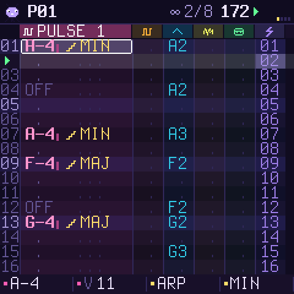

> **Status: 0.1, beta.** It builds, passes the platform's checks and runs in the simulator and the browser
> emulator. It has not been tested on a real FM-1 yet. Installing a custom firmware is at your own risk.
> See [Install](#install) and [Going back](#going-back) before you start.

## Try it in your browser

The firmware's own C code is compiled to WebAssembly, with the FM-1's panel drawn around it:
[`emulateur/index.html`](emulateur/index.html). Open it in Chrome, Edge or Firefox, press **POWER ON**,
then **PLAY**. The page and the screen switch between EN / FR / ES at the top right. You can use the mouse,
touch, or the computer keyboard. A USB MIDI keyboard also works (Web MIDI).


## The idea

- **A real tracker, without the austere look.** Six coloured tracks side by side, with the one under the
  cursor shown wide. Notes are written as `C-4`, drums by name (`KIK`, `SNR`…) and break slices by number
  (`S05`). Each cell has a **trick** shown as an icon: arpeggio, roll, glide…
- **The bottom line always tells you what the four knobs do** on the page you are on.
- **Pocket Operator ideas everywhere.** The 16 white keys are the 16 steps (the GRID page), the 16 live
  effects (hold FX) and the 16 magic tools (LFO).
- **Built for breaks.** The break is cut into 16 slices on the 16 white keys. The black keys play the
  same slice reversed. CHOPPER rewrites a pattern of chops, while keeping a kick on the downbeats and
  snares on 2 and 4.
- **It never plays a wrong note unless you ask for one.** With the scale locked, the keys and knob 1 stay
  in the scale.
- **A mascot** lives in the corner. It hops on the beat and reacts to the effects: it turns upside down on
  REVERSE, squashes on CRUSH and falls asleep on TAPE STOP.

## The panel

| Button | Page | What it does |
| --- | --- | --- |
| **HOME** | TRACKS | the tracker. Hold it for the map of the buttons |
| **SEQ** | GRID | the track's 16 steps on the white keys; black keys 1-6 pick the track |
| **EDIT** | SOUND | the track's sound: PRESETS picks a factory sound, the knobs set its parameters, EDIT again shows the next page |
| **ENV** | MIX | volume, pan, echo and tone per track; the black keys mute tracks |
| **LFO** | MAGIC | 16 tools on the white keys (below) |
| **SCL** | SCALE | the root (press a key), the scale, the lock, how far the cursor moves after a note |
| **GLO** | SONG | tempo, swing, pattern length, loop or song; the song list (the white keys add patterns 1-16) |
| **SAVE** | PROJECTS | 4 slots plus the autosave; knob 3 sets the **language**. Hold SAVE to **undo** |
| **FX** | EFFECTS | hold it and play the white keys; a short tap keeps the page open. OCT-/OCT+ switch the bank |
| **ARP** | — | clears the cell under the cursor |
| **PLAY / REC** | — | play and stop; record (step entry at the cursor, or live on the beat) |

Knobs: **SELECT** moves between rows, **ALGORITHM** picks the track, **PRESETS** picks the pattern (or
the sound, or the song entry). **KNOB 1-4** do what the bottom line says. On TRACKS that is the cell's
note, volume, trick and the trick's value. **MASTER** is the volume.

## The six tracks

| Track | Sound |
| --- | --- |
| PULSE 1, PULSE 2 | band-limited pulse waves at 12.5, 25, 50 or 75 %, or PWM; ADSR, pitch sweep, vibrato, bit crush |
| WAVE | 32-step 4-bit wave tables, Game Boy style: triangle, saw, sine, soft, GB bass, organ, voice, FM |
| NOISE | a 15-bit LFSR, NES style, in LONG or METAL mode, pitched by the note |
| KIT | 16 synthesised drums: kick, gabber kick, snare, clap, hats, toms, cymbal, ride, cowbell, rim, zap, 808, chip kick, chip snare |
| BREAK | four breaks (amen-like, think-like, funky, jungle), synthesised from scratch, 16 slices; can follow the tempo |

Every track has volume, pan, an echo send and a tone filter. The echo is tempo-synced (3/16).

## Tricks (the FX column of a cell)

ARP (14 chords, chiptune speed) · GLIDE · VIBRATO · ROLL (x2 to x32 in one row) · BEND · CHANCE ·
DELAY (in 1/24 of a row) · CUT · REVERSE (a break slice backwards) · PITCH (±12) · SHAPE · CRUSH.

## Live effects (hold FX)

| Key | POCKET bank | WRECK bank |
| --- | --- | --- |
| 1-4 | LOOP 1/16, 1/12, 1/32, 1/64 | CRUSH 4 bits, LO-FI, LOWPASS sweep, HIPASS sweep |
| 5-8 | UNISON, UNISON LOW, OCTAVE +1, OCTAVE −1 | TAPE STOP, DIVE, GATE 1/16, GATE 1/32 |
| 9-12 | STUTTER x4, STUTTER x3, SCRATCH, SCRATCH FAST | FREEZE, RING, ECHO throw, DISTORT |
| 13-16 | 6/8 TRIPLET, RETRIG 1 BEAT, REVERSE, BUILDUP ROLL | WOBBLE, VINYL, NO MELODY, NO BEAT |

Loops lock to the beat: the first pass is the live sound, and then it repeats. Hold several keys at once
to stack effects. With REC on and the music playing, the effects you play are **recorded** into the
pattern's LIVE lane (the thin strip on the right of the tracker). ARP on the EFFECTS page clears that lane.

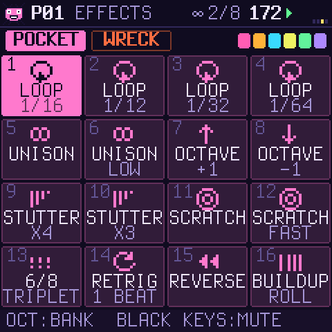

## Magic (LFO)

CHOPPER · BEAT · MELODY · BASS · ARP CHORDS · EUCLID · VARY · ROLLS · ACCENTS · DOUBLE · SHIFT ·
MIRROR · TRANSPOSE · COPY · PASTE · CLEAR. Knob 1 sets the amount, knob 2 the dice, and knob 3 chooses
between the track and the whole pattern. On the whole pattern, each track gets what suits it: a bassline
on WAVE, a beat on the drums, a melody on the pulses. Every tool can be undone (hold SAVE).

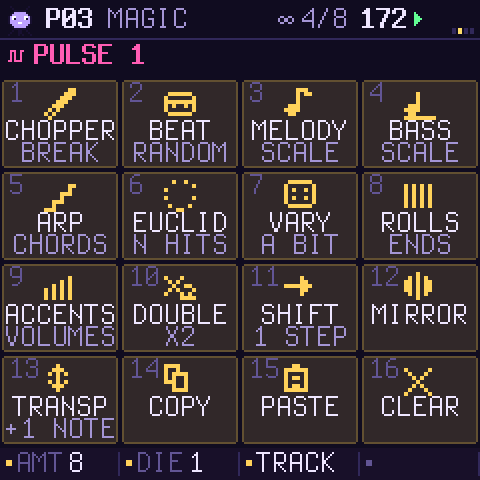

## More screens

| | | |
| --- | --- | --- |
| 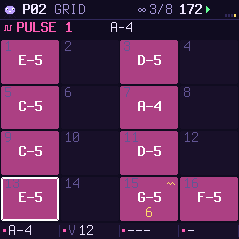 | 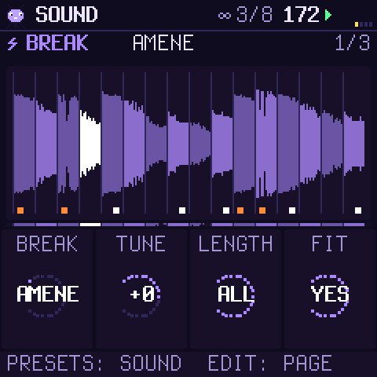 | 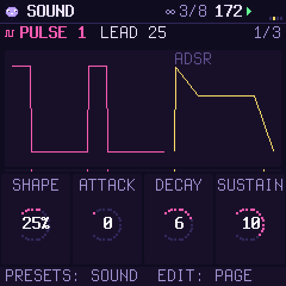 |
| 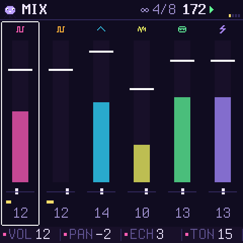 | 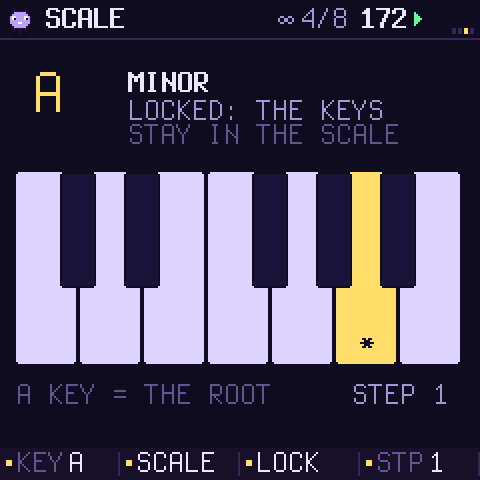 | 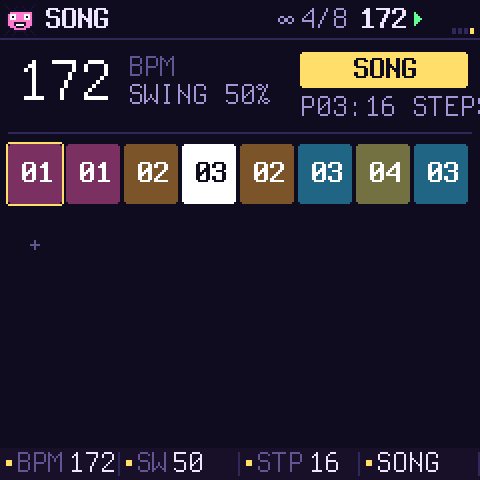 |
| 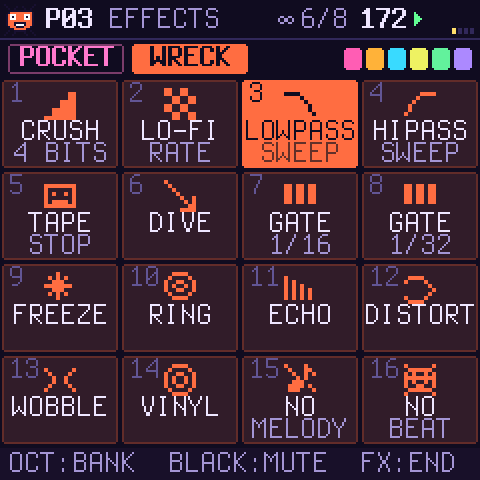 | 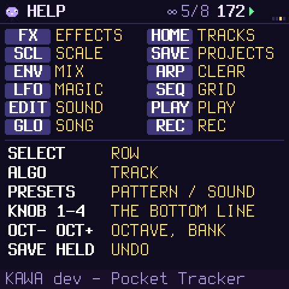 | 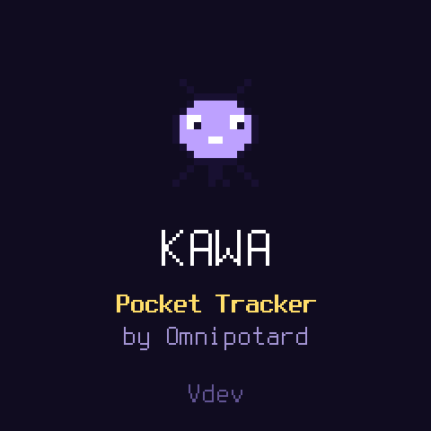 |

## Install

You need the package `release/kawa-0.1.fwsc` (or your own build), a USB data cable, and Python 3 with
`pip3 install mido python-rtmidi`.

```sh
python3 tools/fm1_install.py --info                 # what the connected FM-1 runs
python3 tools/fm1_install.py release/kawa-0.1.fwsc  # asks before it writes, then restarts into KAWA
```

KAWA keeps the update path of its platform, so the installers of the FM-1 community (and M-VAVE's own
updater) can always reach it again.

## Going back

- **To the official firmware:** download FM-1 V15 from M-VAVE's site and install it with M-UPGRADE.
  Another community installer also works, such as the "return to official firmware" option of the Felucca
  or FoMni web installers.
- **If KAWA does not start:** hold **OCT−** while switching on. This opens the USB rescue, with no sound,
  only the updater. If KAWA crashes twice at boot, the FM-1 goes there by itself.
- **If even that is gone:** the chip's boot ROM still answers over USB (`WL80UBOOT`).
  [FM-1 Transporter](https://github.com/kurogedelic/FM-1-transporter) can write the official firmware
  back.

## Build it

- `tests/run_host.sh [script]` runs KAWA on your computer: screens as PNG, sound as WAV. You don't need an
  FM-1 or a toolchain for this.
- `web/make_emulator.sh` builds the browser emulator. It needs clang with the wasm32 target and wasm-ld.
- `./build.sh` builds the FM-1 package. It needs the JieLi toolchain (`tools/get_toolchain.sh`) and three
  files of the JieLi AC79 SDK (Apache-2.0). See [BUILDING.md](BUILDING.md).
- `./build.sh --release 0.1` makes `build/kawa-0.1.fwsc` (package identity `FM-1_951`).
- The art and the tables are generated: `tools/gen_art.py` (icons, mascot), `tools/gen_breaks.py`
  (the breaks, needs numpy), `tools/gen_tables.py`.

The code is in `firmware/src/kawa_*.c`: the voices (`kawa_snd.c`), the live effects (`kawa_fx.c`), the
sequencer (`kawa_seq.c`), editing and the magic (`kawa_edit.c`), drawing (`kawa_gfx.c`) and the pages
(`kawa_ui.c`). The platform under it (`platform.c`, `hal/`, `usb.c`, `ota.c`…) is Dinghy's, unchanged
except for the flash range of the project slots.

## Credits and licence

KAWA by Omnipotard. GPL-3.0-only: you may use, change and share it, and whoever gets a firmware built
from it gets its source too. It stands on [Dinghy](https://github.com/zvenson/dinghy) (zvenson),
[Felucca](https://github.com/hugelton/Felucca) (Leo Kuroshita, Hügelton Instruments) and
[SLOOP](https://github.com/isod89/sloop-fm1) (isod89). Details are in [LICENSING.md](LICENSING.md).
"M-VAVE" and "FM-1" belong to their owners; KAWA is not made or endorsed by them.
